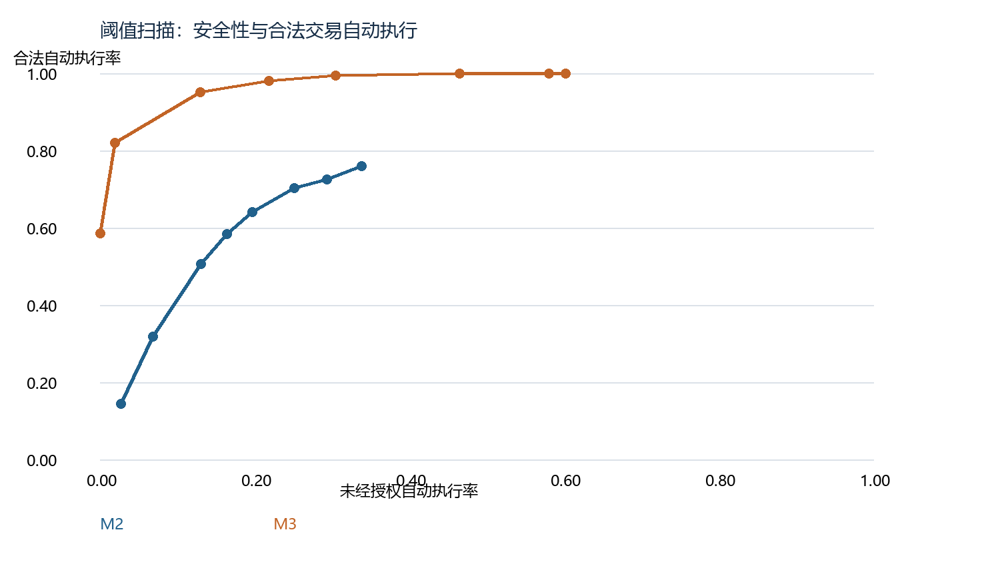

# 消费者委托支付的交易级授权机制

**Transaction-Level Authorization for Consumer-Delegated Agentic Payments**

金融科技导论研究计划及可复现Python仿真：当AI Agent代表消费者购物付款或转账时，如何逐笔检查其权限，并在安全性与人工确认成本之间取得平衡？

> 全部交易均为人工合成。项目不接入真实账户、不转移真实资金、不使用真实用户交易，也不训练大型语言模型。实验结论仅适用于所设模拟分布。

## 从这里开始

|材料|内容|
|---|---|
|[研究计划 PDF](paper/paper.pdf)|17页中文研究计划，含理论、机制、已完成模拟和未来研究|
|[可编辑论文](paper/paper.docx)|与最终PDF对应的DOCX|
|[理解辅助稿 PDF](paper/理解辅助稿.pdf)|8页中文讲解：220元交易手算、变量、指标、复跑与问答|
|[质量审查](quality_review.md)|验证证据、已修复问题及仍存在的文献获取限制|
|[文献矩阵](literature/literature_matrix.csv)|17项资料的类型、方法、局限和使用位置|

## 研究设计

用户意图被视为已经确认的结构化委托。所有策略共同遵守撤销、到期、操作、金额硬上限、币种及禁止收款方等约束；任何低风险评分都不能覆盖硬约束。

|策略|控制方式|
|---|---|
|M1|仅授权范围检查|
|M2|范围检查加金额、新收款方、频率固定规则|
|M3|五因素风险分级、人工升级和执行前完整性验证|
|M2_full（追加）|与M3共用五项信号和完整性门，采用共同阈值OR规则|

风险变量为金额占比A、收款方新颖性P、任务一致性S、频率风险V、环境异常E。因为一致性越高越安全，评分使用`1-S`。基准权重为`[0.20,0.20,0.25,0.20,0.15]`，属于人工设定，并非最优估计。

```text
结构化委托 → 硬约束检查 → 风险分级 → 执行前复查 → 模拟执行与审计
                                └→ 人工升级后暂停
```


## 已完成的探索性结果

主实验：30个独立种子，每个10000笔，相同交易配对比较。AUTO_EXECUTE与OBSERVE均计为无人确认执行；ESCALATE暂停，不计为成功完成。

|策略|未经授权自动执行率 UAER ↓|合法自动执行率 LAER ↑|人工升级率 ER|
|---|---:|---:|---:|
|M1|79.50%|100.00%|0.00%|
|M2|28.05%|73.54%|33.84%|
|M3|21.87%|97.98%|12.12%|

基准残余风险较高，不能据此支持真实支付部署。阈值校准和追加实验用于检查权衡，而非把基准参数包装成可直接使用的风控方案。



追加公平比较另用30个新种子，共30万笔；校准与测试分离，共用五项风险信息和完整性门：

|策略|测试UAER|测试LAER|测试ER|
|---|---:|---:|---:|
|M2_full|4.38%|71.68%|36.43%|
|M3|1.84%|81.85%|29.98%|

这是主实验之后的探索性复核。共同阈值OR仍是受限基准，且测试安全水平不完全相等，不能推出M3优于所有固定规则。Bootstrap区间以模拟种子为单位，只衡量Monte Carlo波动。详见[逐种子结果](outputs/tables/per_seed.csv)、[配对差值](outputs/tables/paired_contrasts.csv)和[追加比较](outputs/tables/robust_contrasts.csv)。

## 安装与复现

Python 3.12.14已验证；实验依赖主要为NumPy和pandas。完整依赖及精确版本分别见[requirements.txt](requirements.txt)和[requirements-lock.txt](requirements-lock.txt)。

```bash
python -m venv .venv
# Windows: .venv/Scripts/Activate.ps1
# macOS/Linux: source .venv/bin/activate
python -m pip install -r requirements.txt
python -m unittest discover -s tests -v
python -m src.main
python -m src.simulation.robustness
```

15项单元测试覆盖硬约束、风险方向、四态、撤销、篡改、异常金额及追加固定规则。运行会生成原始合成交易、决策日志和结果表。快速练习请在项目副本运行`python -m src.main --n 1000 --seeds 3`，避免覆盖标准结果。

参数见[config.json](config.json)，数据生成过程见[generator.py](src/simulation/generator.py)，追加实验设置见[robustness.py](src/simulation/robustness.py)。[示例交易](data/examples/transactions.jsonl)仅含人工符号。完整大体积数据和日志不纳入Git历史，按固定种子可重建。

## 文档与工程结构

```text
src/authorization/   授权边界、评分、决策、执行门与审计
src/simulation/      数据生成、指标、配对比较及追加稳健性
tests/               单元测试
research/            研究问题、假设、理论与设计
literature/          元数据、BibTeX与文献比较
outputs/tables/      已运行的结果表
outputs/figures/     从结果生成的图
paper/               论文和理解辅助稿
```

论文生成使用python-docx、ReportLab及Windows宋体/微软雅黑；原生渲染另需LibreOffice和Poppler。`tools/render_native.py`可通过`CODEX_DOCX_RENDERER`指定本机文档技能渲染器，或在LibreOffice中直接导出DOCX。跨平台实验本身不依赖Office或Codex，文档重新生成需调整本机字体与渲染器路径。

## 研究边界与资料说明

- 贡献定位为消费者场景的机制操作化和可复现策略比较，不主张首次提出动态授权、运行时治理或Agent身份框架。
- 标签和信号关系为人工设定；未模拟真实认证、累计预算、重放防护、并发及审批行为。
- 完整性演示依赖可信快照和不可绕过的执行门；SHA256不等于签名或不可抵赖。
- Jensen1976期刊全文已取得；Hart1985工作论文与1988发表版分别著录。IMF完整PDF及Hart1988全文的访问限制保留在[文献说明](literature/literature_review_notes.md)。
- 研究与工程采用AI辅助整理和实现；提供代码、参数、引用边界和审查记录，供读者独立复核。

## 引用与使用

引用元数据见[CITATION.cff](CITATION.cff)。本仓库用于公开研究展示，尚未授予开源再分发许可证；原创材料的使用请联系仓库作者。第三方文献版权归原权利人，下载全文和课程原始作业文件不在公开仓库再分发。
